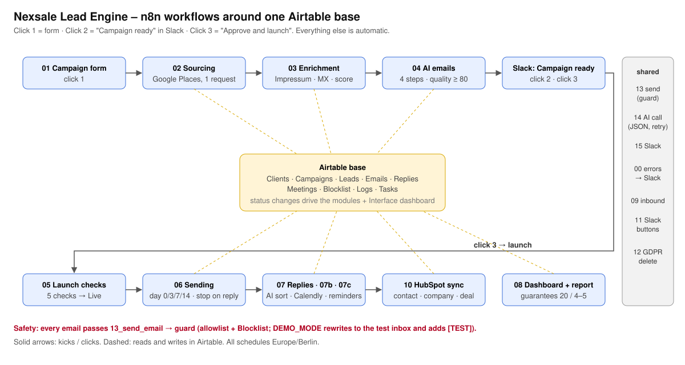

# Nexsale Lead Engine

An automated B2B outbound pipeline in **n8n**: a target customer profile goes in, and scraped leads, AI-written German
email sequences, sorted replies, booked meetings and a client dashboard come out. One person launches a campaign in
**three clicks**; a person is asked again only when the AI is unsure about a reply.

Built as a demo for the interview at Nexsale GmbH (Working Student IT Automation & Software Development).
**Test mode is on by default**: no email can reach a real company (everything goes to the test inbox with `[TEST]`).

Two kinds of campaigns, chosen by the form's **Client** field (empty = Nexsale itself):
- **Nexsale's own outreach**: Nexsale writes to companies it wants as clients (signed by David Gretschmann).
- **Client campaigns**: Nexsale writes **in the client's name** to the client's customers, e.g. Real Service (cleaning) →
  Hausverwaltungen, hotels, clinics. Sender, offer, signature, footer, booking link and qualifying questions come from the
  client record in Airtable.

**New here? Start with the [Handover Guide](docs/HANDOVER.md)** – installation, daily use, testing and troubleshooting.



## Three clicks to launch

| | What happens |
|---|---|
| **Click 1** | Fill in the campaign form (`http://localhost:5678/form/campaign-setup`): name, client, industry, city, size, target role, max leads → lands on a **live status page** |
| auto (≈1–4 min) | Google Places (paged only as far as Max leads needs) → Impressum, team/contact and jobs pages → the **right decision-maker** for the target role, every published email, a **trigger** that fits the offer → MX check → score → AI summary → 4-email German sequence in the client's name → code checks (Nexsale's rules: < 90 / ≤ 50 words, ≤ 5-word subject, one question, no filler) + evidence-based AI quality check (80+, rewrite once) |
| **Click 2** | Open the "Campaign ready" message in Slack: lead count, average score, 3 sample sequences, link to the full list |
| **Click 3** | "Approve and launch": 5 pre-launch checks → Live → emails go out on day 0/3/7/14 (minutes in DEMO_MODE) |
| auto | Reply sorting (rules + AI): **interested** → automatic answer with the client's booking link and qualifying questions (≥ 85 % sure); **question** → drafted answer, one-click approval in Slack; **referral** → intro email to the named colleague; STOP → Blocklist; later / out of office handled. Booking → **AI meeting brief** in Slack and HubSpot. A later "no" closes the HubSpot deal. Live **dashboard** per client: guarantee (20 positive replies, 4–5 meetings) with pace, funnel, cost per meeting, A/B subject test. |

## Modules

| File | Module | Trigger |
|---|---|---|
| `00_error_handler` | Error Workflow of every workflow → Logs + Slack | Error Trigger |
| `01_campaign_setup` · `01b_campaign_status` | Campaign form (click 1) · live status page after submit | Form Trigger · Webhook (GET) |
| `02_lead_sourcing` | Google Places (New) Text Search → Leads | Webhook from 01 |
| `03_enrichment` | Impressum + team/contact + jobs page → decision-maker, email, trigger, register → MX → score | Schedule 5 min + kick from 02 |
| `04_ai_emails` | 4-step sequence, AI quality check, "Campaign ready" (click 2) | Schedule 5 min + kick from 03 |
| `05_campaign_launch` | Pre-launch checks → Live | Slack button (11) / status `Launch` |
| `06_sending` | Sending + follow-ups, daily bounce check | Mon–Fri 08–17 every 15 min (DEMO: every minute) |
| `07_replies` · `07a_gmail_inbox` | Reply sorting and branches · Gmail inbox poller | Gmail Trigger → webhook |
| `07b_calendly` · `07c_reminders` | Bookings · reminders and "held or no-show?" | Calendly webhook · hourly |
| `08_reporting` · `08b_dashboard` | Metrics (hourly), weekly report Monday 08:00 · live dashboard (`/webhook/dashboard`) | Schedule · Webhook (GET) |
| `09_inbound_leads` | Quiz / Meta lead → call task + Slack brief + confirmation | Webhook / form |
| `10_crm_sync` | HubSpot contact, company, deal (idempotent) | Status change (kick) + 15 min |
| `11_slack_actions` | All Slack buttons, signature-verified | Slack interactivity |
| `12_delete_lead` | GDPR deletion, keeps only the Blocklist entry | Webhook |
| `13_send_email` | **The only place that sends email**: Blocklist + safety guard right before the send node | sub-workflow |
| `14_ai_call` | Every AI call: prompt from `prompts/`, JSON only, validated, 1 retry | sub-workflow |
| `15_slack_notify` | Post / update Slack messages, fail loudly on `ok:false` | sub-workflow |

Modules never depend on each other's internals; they talk through Airtable, webhooks and schedules.
Data protection and the go-live checklist: [`docs/datenschutz.md`](docs/datenschutz.md).

## Safety (test mode)

- `DEMO_MODE=true`: every email goes to `TEST_PROSPECT_EMAIL`, subject starts with `[TEST]`, follow-up days become minutes.
- A **guard** right before the only send node stops the run if any recipient is not on `TEST_RECIPIENT_ALLOWLIST`
  (an empty allowlist blocks everything). Real sending would need `DEMO_MODE=false` **and** `ALLOW_REAL_SENDING=true`.
- "Max leads" in the form decides how many companies a campaign gets (test mode too); Google is paged only as far as needed (10 → 1 request). `TEST_LEAD_LIMIT=10` is the default for an empty field.
- Blocklist checked before every send; STOP / unsubscribe is permanent.
- No keys in any file except `.env` (gitignored); a secret scan runs in GitHub Actions.

## Repository

```
code/        logic of every Code node (plain JS) + Jest tests      prompts/   AI prompts (Markdown)
workflows/   importable n8n 1.x JSON – GENERATED, do not edit      setup/     Python 3.11 setup scripts
scripts/     workflow builder, lint, secret scan                   tests/     fixtures, mock server, levels 2–4
docs/        architecture, demo script, decisions, blockers, progress, test report
```

`workflows/*.json` is generated by `npm run build:workflows` from `scripts/workflows/*.js`, which embeds the tested
modules from `code/` and the prompts from `prompts/`. A test fails if the JSON is out of date.

## Setup

1. `cp .env.example .env` and fill it in (step by step: [`docs/HANDOVER.md`](docs/HANDOVER.md), section 3).
2. `docker compose up -d` → n8n on http://localhost:5678 (Postgres, `TZ=Europe/Berlin`). With `COMPOSE_PROFILES=tunnel`, `NGROK_AUTHTOKEN` and `NGROK_DOMAIN` in `.env`, the same command starts an ngrok tunnel on your fixed free domain, so `WEBHOOK_URL` and the Slack Request URL never change.
3. Python: `uv venv --python 3.11 .venv && uv pip install --python .venv requests python-dotenv pytest`
4. `python setup/create_airtable_base.py` (9 tables, safe to run twice) and `python setup/seed_test_data.py --no-replies`
5. `python setup/deploy_workflows.py` – imports/updates all workflows through the n8n API and activates them.
6. In n8n, connect the Gmail OAuth credential (nodes listed in `docs/blockers.md`).

## Tests

| Level | Command | Needs |
|---|---|---|
| 1 Unit | `npm test` (Jest, 80 %+ coverage) · `pytest tests/python` | nothing / mock server |
| 2 Workflow | `python tests/workflows/run_module.py all` | test stack (below) |
| 3 Integration, failure, safety | `python tests/integration/run_integration.py all` | test stack |
| 4 End-to-end | `python tests/e2e/run_e2e.py` (twice in a row) · `--live` for real services | test stack · all keys |

Test stack (real n8n, every external API mocked):

```bash
python tests/mock_server/server.py &
docker compose -p nexsale-test -f docker-compose.yml -f docker-compose.test.yml up -d
python tests/n8n_bootstrap.py && python setup/deploy_workflows.py --test-stack
```

Results: [`docs/test_report.md`](docs/test_report.md) (`npm run report` regenerates it).
